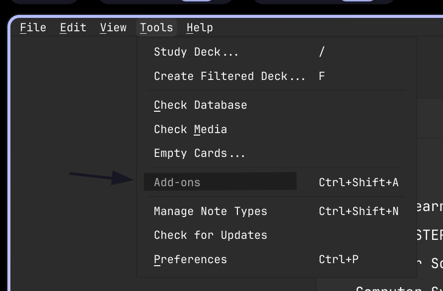
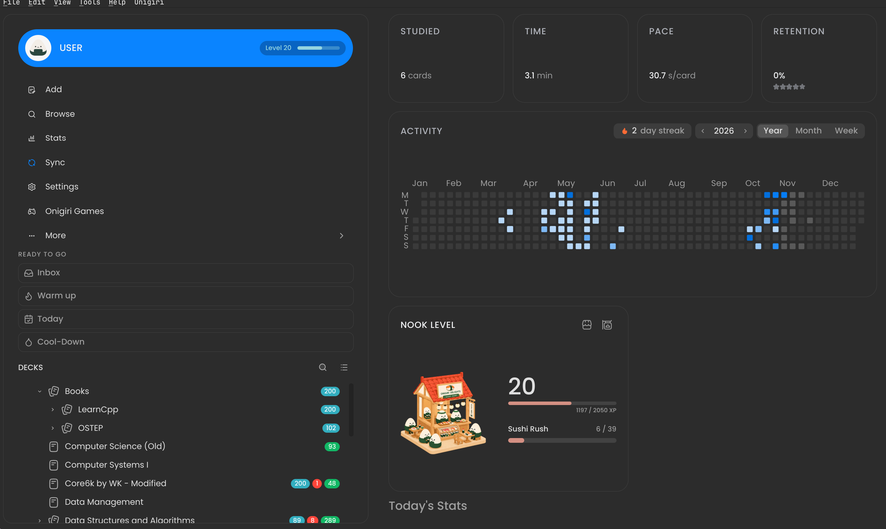
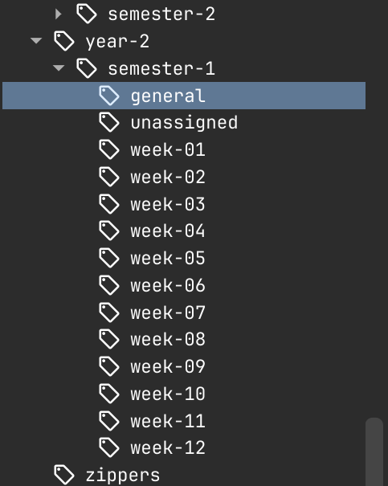

# Southampton study flashcards

PLEASE READ EVERYTHING HERE AND REACH OUT IF YOU DON'T UNDERSTAND

My uni flashcards in anki format, if you use something else im sure you can swap them for something else but everything is pretty reliant on anki. Also think anki is the best flashcard app.

# Repo setup

This is the public half of my repo. The actual files used to generate the flashcards contains copyrighted material so I can't share it. If you want/need access to it reach out to me. 

# Anki setup

You can skip this if you know how to use anki. If you don't have anki install it [here](https://apps.ankiweb.net/) also make an anki web account so that you can sync cards between devices, save your progress and use the online [anki web](https://ankiweb.net/about), Otherwise i'll explain how to get the same setup as me. I have one plugin installed to make anki look slightly nicer (Code: 1011095603). To install it open Anki and at the top hit Tools then Add-Ons or press Ctrl-Shift-A. Once you have the addons page open click on Get Add-ons then enter the codes 1011095603 and hit OK. Restart and it should look more like the image below

Next we need to import the deck which you have hopefully downloaded (its the out.apkg in this repo). At the top of anki hit File then Import (or Ctrl-Shift-I) then select the out.apkg and then import. In the import options leave everything on default then click import in the top right.

Now that you have some decks you can access the deck settings. Right click on any of the imported decks then click on deck options. At the top of the deck options page make sure you are on default (If you want different settings between decks you can create multiple presets but I recommend using one preset for every deck). There are only a few settings I recommend changing but feel free to look them up and use whatever you want. If I don't mention something it's probably cause it should be left on the defaults.

## Daily Limits

I use 200 new cards a day and 9999 reviews a day. You never actually do this many but if your limits are extreme they never get in the way.

## FSRS

**Super important** imo, switch FSRS on, one of the most reliable scheduling algorithms for memory that tailors individual card scheduling to match your memory habits. The gist is that you choose a desired retention rate, and FSRS adjusts how often you see each card to target that chance of remembering it when it’s due.

Higher rate means you get more reviews and lower means you get less, but when you get it you are more likely to get it wrong. I use 0.85 just know that lowering it beyond 0.85 doesn't really lower the no. of cards you get scheduled and raising it increases the no. of cards you get scheduled exponentially. I'd only recommend 0.85-0.9. Probably best if you read up on this if you are curious.

Every now and then open this menu again and hit "Optimise All Presets"

# The cards

There are loads of cards in this deck, too many to review all in one sitting and some cards exist for lectures that haven't happened yet. So I'll explain how to get around some of these issues.

## Decks 

This is obvious but don't study cards from decks you don't care about. Don't study year 1 material if you don't care about it. Just cause it's there doesn't mean you should study it. All the decks are named pretty clearly

## Tags

All cards are tagged with the topic they fall under e.g the year, class, week, topic, etc. The week one is the most important because it's how you can prevent future lecture cards from being scheduled now. 

Each card has the a tag in the format year-x::semester-x::week-xx. It's probably best you unschedule all future weeks to prevent them from showing up. To do this click on browse, it's on pretty much every screen. Scroll down the tags on the left and look for something like this

Click on the tag you want to shedule/unschedule. That will open all the cards on the right with the matching tags. click on one of the list of cards then Ctrl-A to select all the cards then right click one of the selected cards and then you can suspend the cards to not ever get them scheduled. I recommend doing this for all future weeks and probably the general/unassigned tags.

If you ever want them to start being scheduled again its the same concept just unsuspend them.

## Deleting cards

You probably never want to delete cards. Reason being the flashcards are constantly getting updated meaning you have to keep re-importing them every so often. If you delete the card everytime the cards are re-imported you end up adding back the card you deleted. Instead suspend the card which ends up having the same effect as deleting it.

##  Updates

Flashcards are updated roughly once a week. If you want the best flashcards reimport the new out.apkg every so often. Your progress is saved as long as you don't change any settings while importing.

## Sources

Sometimes the flashcards don't really make the most sense by themselves. Each flashcard has the source for what part of the course the flashcard is made from. Normally after reading the source I recognise what the flashcard was trying to convey.

## Books

The flashcards includes flashcards for things not on the syllabus, i cba to seperate them just ignore them.

# Final notes

I've tried to cover everything, i've probably forgotten some stuff, enjoy.